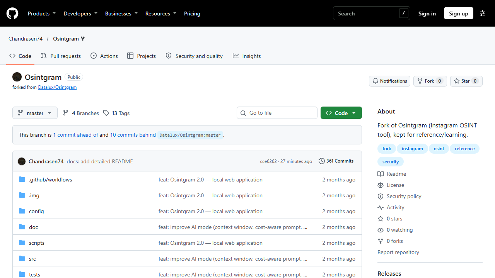

# Osintgram

> Fork/reference repository kept for learning and exploration.

**Repository:** https://github.com/Chandrasen74/Osintgram



## Overview
This is a fork/reference copy of **Osintgram** in my account for study and experimentation.
- **Primary language:** Python
- **Languages detected:** Python, HTML
- **Stack/tech:** Python, HTML
- **Key files:** `Dockerfile`, `requirements.txt`, `src/web/app.py`, `src/web/static/index.html`

## Language & stack details
- Languages: Python, HTML
- Frameworks/tools/libraries: Python, HTML

## How to install & run
### Prerequisites
- [Python 3](https://www.python.org/downloads/) installed

### Setup & run
```bash
git clone https://github.com/Chandrasen74/Osintgram.git
cd Osintgram
pip install -r requirements.txt
python src/web/app.py
```

## Repository structure (top-level/sample)
- `.dockerignore`
- `.github/workflows/tests.yml`
- `.gitignore`
- `.img/web-app.png`
- `.img/web-commands.png`
- `Dockerfile`
- `LICENSE`
- `Makefile`
- `README.md`
- `SECURITY.md`
- `config/credentials.ini.example`
- `doc/CHANGELOG.md`
- `doc/web-ui.md`
- `docker-compose.yml`
- `pytest.ini`
- `requirements-dev.txt`
- `requirements.txt`
- `screenshot.png`
- `scripts/instagrapi_login.py`
- `src/artwork.py`
- `src/instagrapi_backend.py`
- `src/osint_service.py`
- `src/web/__init__.py`
- `src/web/app.py`
- `src/web/cost.py`
- `src/web/dossier.py`
- `src/web/download.py`
- `src/web/history.py`
- `src/web/request_cache.py`
- `src/web/static/index.html`
- `src/web/tools.py`
- `tests/conftest.py`
- `tests/test_app_endpoints.py`
- `tests/test_cost.py`
- `tests/test_docs.py`
- `tests/test_dossier.py`
- `tests/test_download.py`
- `tests/test_instagrapi_backend.py`
- `tests/test_osint_service.py`
- `tests/test_request_cache.py`
- ... and 1 more file(s)

## Notes
- Fork/reference repository; check upstream for canonical source and license details.

## Status
Documented with screenshot, language/stack details, and setup instructions as part of a profile-wide README update.
